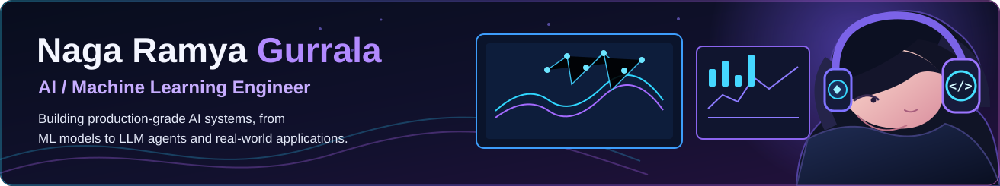
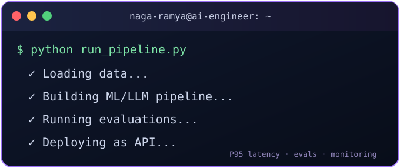

  

<table>
  <tr>
    <td width="50%" valign="top">
      <h2>👋 About Me</h2>
      
I'm an AI / ML Engineer passionate about building end-to-end AI systems, including machine learning models, LLM applications, agentic workflows, and scalable backend services.

      
🎯 <strong>Focus:</strong> Applied AI, LLMs, ML Systems, and Product Engineering

      
💻 I enjoy turning real-world problems into working, production-ready AI solutions.

      
🚀 Always learning, building, and shipping.

    </td>
    <td width="50%" valign="middle">
      
    </td>
  </tr>
</table>

  <strong>🔗 Connect with me:</strong>
  <a href="https://linkedin.com/in/nramyag">LinkedIn</a> &nbsp;·&nbsp;
  <a href="mailto:gurralanagaramya0715@gmail.com">Email</a> &nbsp;·&nbsp;
  <a href="https://github.com/NagaRamya1531-tech">GitHub</a> &nbsp;·&nbsp;
  📍 Melbourne, FL

---

<h2>🧰 Tech Stack</h2>

  

  
  
  
  
  
  
  

---

<h2>🚀 Featured Projects</h2>

<table>
  <tr>
    <td width="33%" valign="top">
      <h3>🕸️ <a href="https://github.com/NagaRamya1531-tech/ToolMesh-AI">ToolMesh AI</a></h3>
      
Policy-aware MCP gateway for discovering and executing tools across REST, MCP, and gRPC services. Includes scoped authorization, approvals, audit trails, and versioned contracts.

      
  

    </td>
    <td width="33%" valign="top">
      <h3>🛍️ <a href="https://github.com/NagaRamya1531-tech/bleecker-bloom-ai-assistant">Bleecker &amp; Bloom</a></h3>
      
End-to-end AI shopping assistant combining multi-agent workflows, hybrid RAG, personalized recommendations, and conversational cart management.

      
  

    </td>
    <td width="33%" valign="top">
      <h3>🛡️ <a href="https://github.com/NagaRamya1531-tech/Fraud_Detection_System">Fraud Detection</a></h3>
      
Transaction classification for imbalanced data using XGBoost, with an interactive monitoring dashboard and event-triggered alerts.

      
  

    </td>
  </tr>
  <tr>
    <td width="33%" valign="top">
      <h3>📈 <a href="https://github.com/NagaRamya1531-tech/Stock_insights-Smart_Market_Prediction_and_Analysis_App">Stock Insights</a></h3>
      
Financial analytics platform combining market data, time-series forecasting, sentiment analysis, and interactive visualizations.

      
  

    </td>
    <td width="33%" valign="top">
      <h3>📝 <a href="https://github.com/NagaRamya1531-tech/draftly">Draftly</a></h3>
      
Full-stack collaborative document workspace with rich-text editing, autosave, persistence, and sharing permissions.

      
  

    </td>
    <td width="33%" valign="top">
      <h3>🧪 <a href="https://github.com/NagaRamya1531-tech?tab=repositories">More Projects</a></h3>
      
Explore additional experiments, ML projects, developer tools, and end-to-end engineering work across my repositories.

      
<a href="https://github.com/NagaRamya1531-tech?tab=repositories">Browse all repositories →</a>

    </td>
  </tr>
</table>

---

<h2>📊 GitHub Stats &amp; Activity</h2>

<table>
  <tr>
    <td width="50%" valign="top">
      
    </td>
    <td width="50%" valign="top">
      
    </td>
  </tr>
</table>

  

---

  <strong>Building useful AI. Engineering reliable systems. Learning in public.</strong> 
  <a href="https://linkedin.com/in/nramyag">Let's connect</a>

